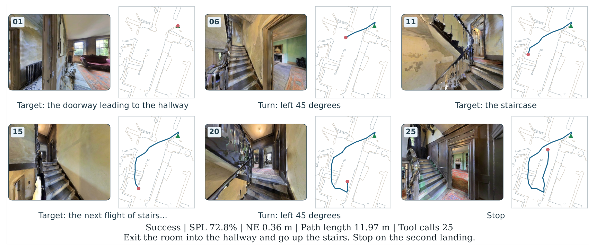
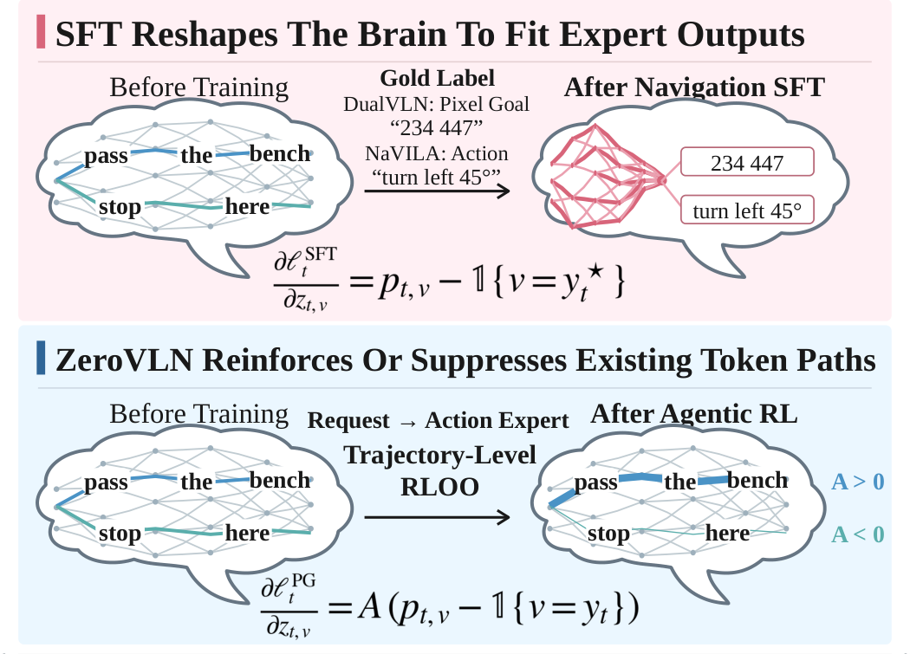
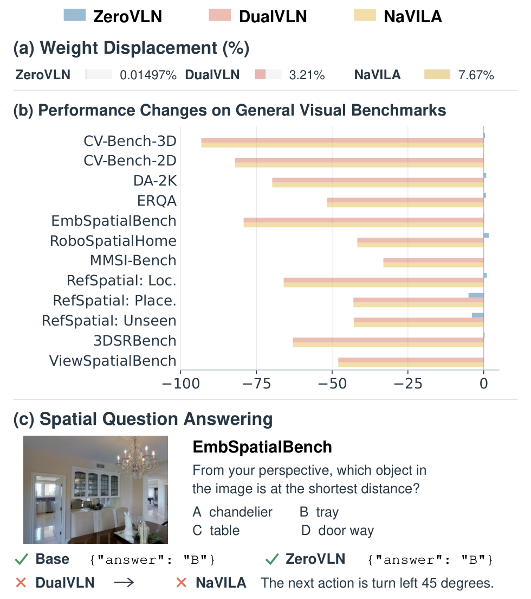

<h1 align="center">ZeroVLN: Learning To Navigate Without Supervised Fine-Tuning Of The VLM Brain</h1>
<p align="center">
  <a href="https://arxiv.org/abs/2611.26414"> <strong>arXiv Paper</strong></a>
  <br>
  <a href="https://huggingface.co/hzxllll/ZeroVLN"> <strong>ZeroVLN Model Weights</strong></a>
</p>
<p align="center"><a href="#benchmark-results">Results</a><br>
  <a href="#quick-start">Quick Start</a><br>
  <a href="#examples">Navigation Examples</a><br>
  <a href="#environment-setup">Installation</a><br>
  <a href="#workflow-deployment">Training And Evaluation</a></p>

**ZeroVLN learns to navigate without navigation-domain supervised fine-tuning (SFT) of its vision-language model (VLM) and largely preserves the model’s general visual capabilities.** To our knowledge, ZeroVLN is the first codebase for vision-and-language navigation in continuous environments (VLN-CE) to jointly train a VLM brain and a continuous-action expert through closed-loop, multi-turn reinforcement learning (RL). The expert first learns to execute the frozen brain’s natural-language movement requests using reference trajectories. During joint training, the brain observes the outcome of each request before choosing the next action. Trajectory-Level RLOO uses the episode return to update both policies. On 12 general visual benchmarks with free-form answers, ZeroVLN achieves **59.16% mean accuracy**, compared with **59.47%** for the base VLM.

The repository provides a **browser-based visualization console and an HTTP Gym interface for R2R-CE, RxR-CE and SAGE-3D**. The console displays the agent’s camera observations and executed trajectory. The Gym interface maintains episode state across interaction rounds so an RL policy can condition its next action on the outcome of its previous tool call.


*ZeroVLN Framework (Figure 2). The expert learns to execute movement requests while the brain is frozen. During joint RL, a shared trajectory-level advantage updates both policies.*

## Benchmark Results

The table reports success rate (SR) and success weighted by path length (SPL), in that order. Relative to ZeroVLN (Init), joint RL increases SR from **36.9% to 51.3%** on SAGE-3D, **17.0% to 52.7%** on R2R-CE, and **18.7% to 51.4%** on RxR-CE.

| <div align="center">Method</div> | <div align="center">SAGE-3D</div> | <div align="center">R2R-CE</div> | <div align="center">RxR-CE</div> |
| --- | ---: | ---: | ---: |
| Direct Tool Use | 39.5% / 24.5% | 19.0% / 10.2% | 21.8% / 13.5% |
| ZeroVLN (Init) | 36.9% / 20.3% | 17.0% / 8.40% | 18.7% / 9.61% |
| ZeroVLN (Ours) | **51.3% / 32.0%** | **52.7% / 29.2%** | **51.4% / 28.1%** |

## Supported Workflows

| <div align="center">Task</div> | <div align="center">Required Inputs</div> | <div align="center">Documentation</div> |
| --- | --- | --- |
| Visualize Or Evaluate A Policy | Brain, action-expert checkpoint and benchmark scenes | [Browser Console](#browser-console)<br>[Closed-Loop Evaluation](#closed-loop-evaluation) |
| Run A Custom Policy | Running Gym service and an episode from the case manifest | [Start The Gym](#training-gym-and-http-client)<br>[Python Client Example](#multi-round-interaction-with-the-gym) |
| Collect Supervision And Train The Action Expert | A collection plan for the planner, or published trajectories and indices for training | [Collect Reference Trajectories](#reference-trajectory-collection)<br>[Initialize The Expert](#action-expert-initialization) |
| Jointly Optimize The Brain And Expert | Initialized expert, base brain, training cases and Gym services | [Single-Node Training](RUNTIME_VALIDATION.md#one-joint-rl-update-on-16-devices)<br>[Distributed Training](#joint-reinforcement-learning) |

## Quick Start

**1. Download The ZeroVLN Model Weights.** The [ZeroVLN Model Weights](https://huggingface.co/hzxllll/ZeroVLN/tree/feebe03ffc987e034fc9b1fb4f15774f83a2d9dc) include the jointly trained VLM brain, action expert and learnable query embeddings (70.4 GB). Complete [Environment Setup](#environment-setup), then set the benchmark paths and `FAST_BACKBONE` in `scripts/env/environment.local.sh`. The action expert requires a separate frozen Qwen3.5-4B visual backbone. Set `FAST_BACKBONE` to its local directory and run the following commands from the repository root.

```bash
source ./scripts/env/environment.local.sh
export PATH="$(dirname "$PYTHON"):$PATH"
export INITIAL_CHECKPOINT="$RL_ARTIFACT_ROOT/checkpoints/ZeroVLN"

# With the Hugging Face CLI installed, sign in using an account with read access.
hf auth login
hf download hzxllll/ZeroVLN --revision feebe03ffc987e034fc9b1fb4f15774f83a2d9dc \
  --local-dir "$INITIAL_CHECKPOINT"
"$PYTHON" scripts/prepare_checkpoint.py "$INITIAL_CHECKPOINT"
```

**2. Run A Navigation Episode.** The evaluator validates the checkpoint using `report.json` and loads the VLM brain from `qwen/`. The action expert and learnable query embeddings are in `action_head/` and `learnable_query/`, respectively. In the same shell, select the training configuration included with the checkpoint and launch the console with a new output directory.

```bash
export SLOW_MODEL="$INITIAL_CHECKPOINT/qwen"
export TRAINING_CONFIG="$INITIAL_CHECKPOINT/training_config.json"
./scripts/eval/run_navigation.sh --config configs/gpu/evaluation.json \
  --output-dir "$RL_ARTIFACT_ROOT/navigation-console" --port 5002
```

Open `http://127.0.0.1:5002` on the host, or forward port 5002 to your local machine. Select a benchmark, scene and instruction, then load the initial observation and run the policy. The console displays the camera view, trajectory and tool calls for each interaction round. For batch evaluation, the [Evaluation Example](RUNTIME_VALIDATION.md#one-navigation-case-per-benchmark) runs one episode per benchmark and records completion in `smoke/smoke-summary.json`.

## Examples

### R2R-CE Navigation Example

In this R2R-CE episode, the instruction is “Exit the room into the hallway and go up the stairs. Stop on the second landing.” The agent turns left to locate the staircase at call 6, targets the next flight at call 15 and stops 0.36 m from the goal at call 25. The camera views show the agent’s observations, and the trajectory records its executed motion.



### Multi-Round Interaction With The Gym

The example initializes a Gym session with one episode from the training manifest, executes two turn actions and prints the reward and termination flags after each action. An RL worker can use the returned observation to select its next action. Start the [Training Gym](#training-gym-and-http-client) and set `TRAIN_CASES` and `BENCH_URLS` before running the client.

<details>
<summary>Reset A Gym Session, Take Two Steps And Close It In Python</summary>

```python
import json
import os
from urllib.request import Request, urlopen
from uuid import uuid4

with open(os.environ["TRAIN_CASES"]) as cases:
    case = json.loads(next(line for line in cases if line.strip()))
gym = os.environ["BENCH_URLS"].split(",")[0].strip().rstrip("/")
session = f"{gym}/sessions/{uuid4().hex}"

def post(endpoint, payload):
    request = Request(f"{session}/{endpoint}", data=json.dumps(payload).encode(),
                      headers={"Content-Type": "application/json"})
    with urlopen(request, timeout=600) as response:
        return json.load(response)

case_fields = ("backend", "scene", "episode_id", "instruction")
initial = post("reset", {key: case[key] for key in case_fields})
try:
    for direction in ("left", "right"):
        action = {"name": "turn", "arguments": {"direction": direction, "degrees": 45}}
        step = post("step", {"action": action})
        print(direction, step["reward"], step["terminated"], step["truncated"])
        if step["terminated"] or step["truncated"]:
            break
finally:
    post("close", {})
```

</details>

For movement, the [Python Client](verl/action_head/render_client.py) also sends waypoint prefixes predicted by the action expert. For visualization, the [Gym Server](vln_demo/src/vln_gym/server.py) exposes `frame.jpg` and `map.jpg` under the same session URL.

## Key Features

### Joint Optimization Of The Brain And Action Expert

Navigation success depends on both the movement requested by the brain and the trajectory executed by the action expert. A request to approach a staircase, for example, may lead to different subsequent observations depending on whether the expert reaches the entrance. ZeroVLN trains these policies in two stages.

1. **Ground The Brain’s Movement Requests.** With the base brain frozen, collect its own requests in simulation. A trajectory planner locates the requested target and supplies a reference trajectory. The expert learns to execute a prefix, refresh its camera view, and plan again. This initializes the expert without navigation-domain supervised fine-tuning of the brain.
2. **Improve Both Policies From The Same Rollouts.** Sample several trajectories for the same episode. Trajectory-Level RLOO compares each return with the other returns in the group and uses the resulting advantage to update the brain’s tool choices and the expert’s motion. The return includes distance progress, information discovery, first arrival, and terminal success. The brain learns when to issue its own STOP.

<p align="center"></p>

*Figure 6. How Navigation Feedback Trains The Brain.* A request such as “pass the bench” can succeed or fail depending on where the expert moves. Trajectory-Level RLOO increases the probability of sampled requests associated with better returns and reduces it for those associated with worse returns. The brain can therefore improve its navigation decisions using its existing language interface, without learning a dataset-specific coordinate or action format.

### Visualization And Gym Access Across Three Benchmarks

In the **browser console**, select a benchmark, scene and instruction to inspect an episode. The camera view shows the observation available to the agent. The trajectory map and tool-call history show how each movement request or turn changes the agent’s pose and where it issues STOP.

The **HTTP Gym interface** exposes the same environments to rollout workers. Each session corresponds to one episode. A worker submits an action using the session ID and receives the next observation, reward, termination flags and diagnostic information.

| <div align="center">Benchmark</div> | <div align="center">Environment</div> | <div align="center">Backend</div> |
| --- | --- | --- |
| R2R-CE | Matterport3D scenes in Habitat | `r2r` |
| RxR-CE | Matterport3D scenes in Habitat | `rxr` |
| SAGE-3D | Gaussian-splat scenes with navigation geometry | `sage` |

<details>
<summary>Training And Inference Components</summary>

| <div align="center">Component</div> | <div align="center">Role</div> | <div align="center">Implementation</div> |
| --- | --- | --- |
| Environment Services | Render observations, advance the simulator, and score interactions | [Gym Service Launcher](scripts/train/rloo/run_rl_services.sh) |
| Rollout Workers | Keep episode state across calls and collect trajectories from the brain and expert | [Rollout Worker](verl/action_head_rl/rollout.py) |
| Brain Inference | Serve the VLM for tool decisions during rollout | [vLLM Service](verl/action_head_rl/vllm_service.py) |
| Joint Learner | Coordinate distributed updates to the brain and expert and save their training state | [Trainer](verl/action_head_rl/trainer.py)<br>[Megatron Worker](verl/action_head_rl/megatron_worker.py) |
| Experiment Configurations | Select joint, brain-only, or expert-only updates, trajectory- or round-level credit, and reward ablations | [RL Configuration](configs/gpu/rloo.yaml) |

</details>

## Joint RL Ablation Results


*Figure 12. Joint Optimization And Reward Ablations.* The top row varies which parameters receive RL updates. Training the brain alone reduces success as training proceeds, while training the expert alone stays close to initialization. Joint updates improve success and reduce navigation error. The bottom row measures the effect of removing each reward component.

### General Visual Capabilities After Navigation Training

<p align="center"></p>

*Figure 7. Small Brain Updates And Retained Visual Skills.* After joint RL, the brain’s relative weight displacement is **0.01497%**. On twelve general visual benchmarks evaluated with free-form answers, ZeroVLN achieves **59.16% mean accuracy**, compared with **59.47%** for the base brain. In the pictured spatial question, both models identify the tray as the closest object. These evaluations show that the navigation gains above come with little change in mean visual accuracy.


*Figure 8. Visual Judgments Across Seven Benchmarks.* We score the same 100 questions per benchmark by selecting the answer label with the highest next-token probability, so generating a correctly formatted response is unnecessary. ZeroVLN answers **434 of 700** questions correctly (**62.00%**), compared with **440 of 700** for the base brain (**62.86%**). ZeroVLN matches the base VLM’s accuracy on CV-Bench 3D, CV-Bench 2D, and 3DSRBench, retaining **98.64% of base accuracy** across all seven.

## Environment Setup

Use Linux, Bash and Python 3.12. ZeroVLN uses separate Python environments for training and simulation. For distributed runs, use the same absolute paths for the repository, checkpoints and datasets on every node. Store shared outputs on a filesystem accessible to all nodes and compilation caches on local storage.

<details>
<summary>Clone The Repository And Install The Training And Simulation Environments</summary>

```bash
git clone https://github.com/hzx122/ZeroVLN.git
cd ZeroVLN
export REPO="$PWD"
cp scripts/env/environment.example.sh scripts/env/environment.local.sh
```

**Create The Training And Simulation Environments.** The training environment runs the learner and rollout workers. The simulation environment runs Habitat and the navigation services with NumPy 1.26.4. Create both environments from the repository root.

```bash
export ENV_ROOT="$HOME/.venvs/zerovln"
for name in train demo; do
  python3.12 -m venv "$ENV_ROOT/$name"
  "$ENV_ROOT/$name/bin/python" -m pip install 'setuptools>=77,<81' wheel 'cmake<4' ninja packaging
done
train="$ENV_ROOT/train/bin/python"
demo="$ENV_ROOT/demo/bin/python"
```

Follow the [Installation Guide](REQUIREMENTS.md) to install compatible PyTorch and torchvision builds in both environments. Then install the Python packages for each workflow in the same shell.

```bash
"$train" -m pip install -r requirements/train.txt
"$demo" -m pip install -r requirements/demo.txt
```

For simulation, install the compatible Habitat-Sim, Habitat-Lab, Magnum and EGL dependencies listed in the installation guide. Evaluation and RL use the bundled CPU renderer for SAGE-3D by default. GPU rendering for trajectory collection also requires the rasterizer and nearest-neighbor extensions. For model serving, follow the backend-specific instructions in the guide. Joint RL requires a vLLM build compatible with the training environment because inference and learning share accelerators.

</details>

<details>
<summary>Set Model And Dataset Paths And Verify The Interpreters</summary>

**Configure The Host.** Edit the absolute paths in `scripts/env/environment.local.sh`. Set `PYTHON` to the training interpreter above and `RYNNBRAIN_VENV` to the demo environment directory. Install the external source trees and supply the inputs used by your workflow:

- **Navigation Assets.** Set `RYNNBRAIN_NAV_DIR` to the RynnBrain `navigation/` checkout with its `data/` tree, R2R/RxR episodes and licensed Matterport3D scenes under `data/scene_datasets/mp3d/`. For SAGE, set `SAGE_ROOT` to the dataset containing `SAGE-3D_VLN_Data` and `InteriorGS`, `SAGE_SCENES_ROOT` to the converted Gaussian scenes, and `SAGE_USD_COLLISION_MASK_ROOT` to the collision masks. Evaluation also reads `SAGE_MANIFEST`, `SAGE_PROTOCOL_ROOT` and `NAVMESH_ROOT`.
- **Model And Checkpoint.** Set `SLOW_MODEL` to the Qwen3.6-35B-A3B brain and `FAST_BACKBONE` to the Qwen3.5-4B visual backbone. Set `INITIAL_CHECKPOINT` to the checkpoint directory containing the action expert and learnable query weights, and `TRAINING_CONFIG` to its matching experiment configuration. See the evaluation step below when selecting a jointly trained brain.
- **Training Source And Data.** Set `VERL_SOURCE_ROOT` to the upstream VERL checkout for that stage. The required revisions differ between expert initialization and joint RL. For joint RL also install Megatron Core and Bridge under `MEGATRON_ENV/mcore` and `MEGATRON_ENV/bridge/src`. The VERL revisions and required APIs are in the [Dependency Notes](DEPENDENCIES.md). The stage-specific data inputs are listed below.

Source the file in each new shell. Verify the training interpreter, accelerator visibility and simulator imports before starting the services.

```bash
source ./scripts/env/environment.local.sh
export PATH="$(dirname "$PYTHON"):$PATH"
mkdir -p "$RL_ARTIFACT_ROOT" "$GPU_CACHE_ROOT"
"$PYTHON" -c 'import torch; print(torch.__version__, torch.cuda.device_count())'
"$RYNNBRAIN_VENV/bin/python" -c 'import habitat, habitat_sim, magnum, numpy; print(numpy.__version__)'
```

</details>

## Workflow Deployment

Use the shell launchers under `scripts/train/` for collection and training, `scripts/eval/` for evaluation and navigation, and `scripts/env/` for host configuration. Under `scripts/train/rloo/`, `sequence/` contains the trajectory-level training scripts and `turn/` contains the round-level variants.

Run each launcher from the repository root with the host environment sourced. Expand a task for its required inputs, commands and expected outputs.

### Reference Trajectory Collection

<details>
<summary>Collection Plan, Launch Command And Output Checks</summary>

Prepare a collection plan for `sage`, `r2r` or `rxr` in a new run directory under `RL_ARTIFACT_ROOT`. Set `source_plan` to the JSON file that records the inputs and their provenance and `environment` to the environment variables for the workers. Use `services` to specify the model and simulator commands, ports and health-check URLs, and `collectors` to specify worker commands and output paths. Provide the referenced assets on the collection host and use a separate node-local `runtime` directory for each run.

```bash
: "${COLLECTION_PLAN:?Set the absolute path to your prepared collection plan JSON}"
./scripts/train/run_collection.sh --plan "$COLLECTION_PLAN" --show-config
./scripts/train/run_collection.sh --plan "$COLLECTION_PLAN"
```

The launcher starts collection once the model and simulator services pass their health checks. After collection, inspect the episode outputs, confirm that `completion.json` reports `status: complete`, and check the exit code in `launch/gpu-collection.json`. Expert training reads a manifest covering all three benchmarks and a separate index for each benchmark.

</details>

### Action-Expert Initialization

<details>
<summary>Data Preparation, Initialization And Distributed Training</summary>

Use the [Open-Loop Configuration](configs/gpu/openloop.json). Set `PUBLISHED_INPUTS` to the published three-source input JSON, `PUBLISHED_INDEX` to the index root containing `sage/summary.json`, `r2r/summary.json` and `rxr/summary.json`, and `BASE_HEAD_CHECKPOINT` and `BASE_QUERY_CHECKPOINT` to the initialization weights. The reference trajectories and indexed shards listed in these files must be mounted on the training hosts.

```bash
out="$RL_ARTIFACT_ROOT/openloop"
# Run once on node 0 with a fresh output path.
./scripts/train/run_openloop.sh prepare --output-dir "$out"
./scripts/train/run_openloop.sh initialize --output-dir "$out"
# Then run on each node. Use its own NODE_RANK and the same node-0 MASTER_IP.
./scripts/train/run_openloop.sh run --output-dir "$out" --node-rank "${NODE_RANK:?}" \
  --master-addr "${MASTER_IP:?}" --master-port 29561
```

The default expert training configuration uses four nodes with 16 accelerators per node. The [Single-Node Example](RUNTIME_VALIDATION.md#bounded-action-expert-training) uses four accelerators. Check the exit code in `launch/run-node<RANK>.json` and inspect `report.json` to verify that the expert parameters changed while the brain remained frozen. For joint RL, set `INITIAL_CHECKPOINT` to the resulting checkpoint and retain `experiment_config.json` for evaluation.

</details>

### Browser Console

Start the console with the [Quick Start](#quick-start). Service logs are under `navigation-console/console/services/`. Stop the foreground launcher with Ctrl-C.

### Training Gym And HTTP Client

<details>
<summary>Gym Startup, Health Check And Shutdown</summary>

On a simulator host, set `TRAIN_CASES` to the three-source training JSONL. For information rewards, supply `SAGE_SOURCE_OBJECT_MAP`, its published `SAGE_SOURCE_OBJECT_MAP_SHA256`, `SAGE_NAVMESH_ROOT`, and `MP3D_HOUSE_ROOT` containing `<scene>/<scene>.house`. This example starts eight training Gym instances and their CPU renderers on one node. Run it in Bash with the host environment sourced:

```bash
export EXPR_NAME=gym-demo TRAIN_GYMS=8 TRAIN_PORT_BASE=24850
export RENDER_PORT=24840 CPU_RENDER_PORT=24841
export BENCH_URLS=$(printf 'http://127.0.0.1:%s,' {24850..24857})
export BENCH_URLS=${BENCH_URLS%,}
./scripts/train/rloo/run_rl_services.sh run.mode=start
./scripts/train/rloo/run_rl_services.sh run.mode=status
curl -fsS http://127.0.0.1:24850/spec
```

Once status reports `ready: true`, run the [Reset, Step And Close Example](#multi-round-interaction-with-the-gym) in the same environment. A working session returns a new observation, reward and termination flags after a turn. Run `./scripts/train/rloo/run_rl_services.sh run.mode=stop` with the same environment when finished. Remote workers need the simulator host’s reachable address in `BENCH_URLS`.

</details>

### Joint Reinforcement Learning

<details>
<summary>Ray Cluster, Gym Services And Joint Learner</summary>

Joint training requires the initialized action expert, the base VLM, the episode manifest and access to the Gym services. The [Single-Node Example](RUNTIME_VALIDATION.md#one-joint-rl-update-on-16-devices) uses 16 accelerators, starts eight Gym instances and saves a joint checkpoint. The [Distributed Training Configuration](configs/gpu/rloo.yaml) uses eight nodes with 16 accelerators per node and 512 rollout workers in total.

1. Activate the same training environment on all nodes. Use an existing Ray cluster spanning the allocated hosts, or start Ray on the head and then join the other nodes. Set `MASTER_IP` to the head node’s reachable IP on all hosts. If starting a new cluster, run `ray start --head --node-ip-address="$MASTER_IP" --port=6379` on the head and `ray start --address="$MASTER_IP:6379"` on each worker. Confirm all eight nodes appear in `ray status` on the head.
2. Start local services on **each** node. Use the same experiment name and method settings everywhere. Give each node its own service output directory on shared storage. The default service ports are 8950–9013 for 64 Gym instances per node.
3. Start **one** learner on the head. Set `BENCH_URLS` to one distinct, reachable URL per rollout worker across all nodes. The example below reads a text file containing one reachable hostname or IP per line for the eight nodes.

```bash
# On every node, with a fresh EXPR_NAME and a different NODE_RANK (0 through 7).
export EXPR_NAME=trajectory-rloo TRAIN_GYMS=64 TRAIN_PORT_BASE=8950
export RAY_ADDRESS="${MASTER_IP:?}:6379"
export SERVICES_OUTPUT_DIR="$RL_ARTIFACT_ROOT/$EXPR_NAME-services-node${NODE_RANK:?}"
./scripts/train/rloo/run_rl_services.sh run.mode=start
./scripts/train/rloo/run_rl_services.sh run.mode=status

# On the head only, after all service groups are ready.
: "${GYM_HOSTS_FILE:?Set the path to the eight-host text file}"
BENCH_URLS=$("$PYTHON" - "$GYM_HOSTS_FILE" <<'PYTHON'
from pathlib import Path
import sys

hosts = Path(sys.argv[1]).read_text().split()
if len(hosts) != 8 or len(set(hosts)) != 8:
    sys.exit("Expected eight distinct Gym hosts")
print(",".join(f"http://{host}:{port}" for host in hosts for port in range(8950, 9014)))
PYTHON
)
export BENCH_URLS
./scripts/train/rloo/run_rloo.sh --cfg job --resolve
./scripts/train/rloo/run_rloo.sh "run.output_dir=$RL_ARTIFACT_ROOT/$EXPR_NAME"
```

Inspect `train/rollouts.jsonl` for episode trajectories, `train/training_updates.jsonl` for updates to each policy, and `train/metrics.jsonl` for training metrics. Verify that the learner wrote the checkpoint. To stop the services, run `./scripts/train/rloo/run_rl_services.sh run.mode=stop` on each node using the environment settings from startup. Runtime validation covers the single-node configuration.

</details>

### Closed-Loop Evaluation

<details>
<summary>Checkpoint Selection, Launch Commands And Metrics</summary>

In the [Evaluation Configuration](configs/gpu/evaluation.json), each entry specifies the checkpoint directory for the action expert and learnable queries (`path`), the matching training configuration (`training_config`) and the VLM weights (`brain`). Use the base VLM for ZeroVLN (Init). For the jointly trained model, set `SLOW_MODEL="$INITIAL_CHECKPOINT/qwen"` to load the VLM exported with that expert. The browser console uses the same configuration.

The [Evaluation Example](RUNTIME_VALIDATION.md#one-navigation-case-per-benchmark) uses two accelerators to run one episode per benchmark. A successful run writes `complete: true` and `ok: true` to `smoke/smoke-summary.json`. The default evaluation uses four nodes, four repeats and a limit of 200 tool calls per episode.

```bash
out="$RL_ARTIFACT_ROOT/evaluation"
# On node 0, once, before any worker starts.
./scripts/eval/run_evaluation.sh prepare --config configs/gpu/evaluation.json --output-dir "$out"
# On every configured node, using the same selection and shared output path.
./scripts/eval/run_evaluation.sh run --config configs/gpu/evaluation.json \
  --output-dir "$out" --rank "${NODE_RANK:?}"
```

Each rank writes `launch/run-node<RANK>.json`. After the ranks finish, read `run/summary.json` for the aggregated checkpoint metrics and evaluation validity. A completed episode can have zero navigation success; infrastructure errors and incomplete episodes require checking the corresponding rank and service logs.

</details>

## Acknowledgements

ZeroVLN uses Habitat for R2R/RxR simulation, the ABot renderer for SAGE-3D scenes, and VERL, Megatron, and vLLM for training and inference. See the [Dependency Notes](DEPENDENCIES.md) for integration details and third-party attribution.
