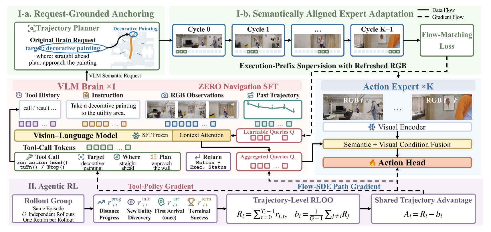
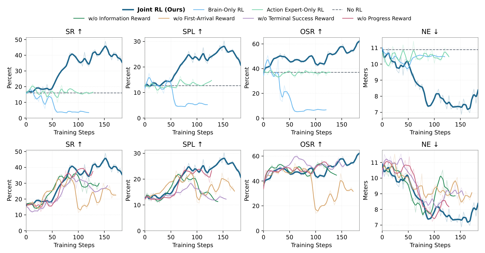
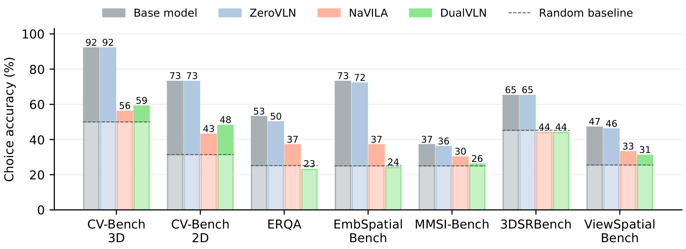

<h1 align="center">ZeroVLN: Learning to Navigate without Supervised Fine-Tuning of the VLM Brain</h1>
<p align="center">
  <a href="https://arxiv.org/abs/2611.26414"> <strong>arXiv paper</strong></a>
  &emsp;
  <a href="https://huggingface.co/hzxllll/ZeroVLN"> <strong>Hugging Face model</strong></a>
</p>
<p align="center"><a href="#benchmark-results">Results</a> &ensp; <a href="#quick-start">Quick start</a> &ensp; <a href="#examples">Navigation examples</a> &ensp; <a href="#environment-setup">Installation</a> &ensp; <a href="#workflow-deployment">Training and evaluation</a></p>

**ZeroVLN learns to navigate without navigation-domain supervised fine-tuning (SFT) of the VLM brain and largely preserves the brain’s general visual capabilities.** To our knowledge, it is the first VLN-CE codebase to jointly train a VLM brain and a continuous-action expert through closed-loop, multi-turn reinforcement learning. The expert first learns to execute the frozen brain’s natural-language movement requests from reference trajectories. During joint RL, the brain observes the result of each request before choosing the next, and Trajectory-Level RLOO uses the episode return to improve both policies. Across 12 general visual benchmarks with free-form answers, ZeroVLN achieves **59.16% mean accuracy**, close to the base brain’s **59.47%**.

The repository includes a **browser console and an HTTP Gym for R2R-CE, RxR-CE and SAGE-3D**. Inspect the camera view and executed path in the browser, or keep a Gym session open across interaction rounds so your policy can observe the result of one tool call before choosing the next.



*ZeroVLN framework (Figure 2). The expert learns to execute movement requests while the brain is frozen. During joint RL, a shared trajectory-level advantage updates both policies.*

## Benchmark results

Joint RL raises the success rate from **36.9% to 51.3%** on SAGE-3D, **17.0% to 52.7%** on R2R-CE, and **18.7% to 51.4%** on RxR-CE. Each table entry gives the success rate (SR) followed by success weighted by path length (SPL).

| Method | SAGE-3D | R2R-CE | RxR-CE |
| --- | ---: | ---: | ---: |
| Direct Tool Use | 39.5% / 24.5% | 19.0% / 10.2% | 21.8% / 13.5% |
| ZeroVLN (Init) | 36.9% / 20.3% | 17.0% / 8.40% | 18.7% / 9.61% |
| ZeroVLN (Ours) | **51.3% / 32.0%** | **52.7% / 29.2%** | **51.4% / 28.1%** |

## What you can do with ZeroVLN

| Task | What you need | Start here |
| --- | --- | --- |
| Watch or evaluate a checkpoint | Brain, action-expert checkpoint and benchmark scenes | [Browser console](#browser-console) · [Closed-loop evaluation](#closed-loop-evaluation) |
| Run your own policy across interaction rounds | Reachable training Gym and an episode from the case manifest | [Start the Gym](#training-gym-and-http-client) · [Python client example](#drive-a-gym-session-from-an-rl-worker) |
| Collect supervision and train the action expert | A collection plan for the planner, or published trajectories and indices for training | [Collect reference trajectories](#reference-trajectory-collection) · [Initialize the expert](#action-expert-initialization) |
| Jointly optimize the brain and expert | Initialized expert, base brain, training cases and Gym services | [16-device deployment](RUNTIME_VALIDATION.md#one-joint-rl-update-on-16-devices) · [Full recipe](#joint-reinforcement-learning) |

## Quick start

**1. Download the ZeroVLN model.** The [ZeroVLN weights on Hugging Face](https://huggingface.co/hzxllll/ZeroVLN/tree/feebe03ffc987e034fc9b1fb4f15774f83a2d9dc) contain the jointly trained brain, action expert and learnable query embeddings (70.4 GB). On a configured host, run the following in Bash from the ZeroVLN repository root. First complete [environment setup](#environment-setup) and set the benchmark asset paths and `FAST_BACKBONE` in `scripts/env/environment.local.sh`. The expert uses a separate frozen Qwen3.5-4B visual backbone. Set `FAST_BACKBONE` to your local copy.

```bash
source ./scripts/env/environment.local.sh
export PATH="$(dirname "$PYTHON"):$PATH"
export INITIAL_CHECKPOINT="$RL_ARTIFACT_ROOT/checkpoints/ZeroVLN"

# With the Hugging Face CLI installed, sign in using an account with read access.
hf auth login
hf download hzxllll/ZeroVLN --revision feebe03ffc987e034fc9b1fb4f15774f83a2d9dc \
  --local-dir "$INITIAL_CHECKPOINT"
"$PYTHON" scripts/prepare_checkpoint.py "$INITIAL_CHECKPOINT"
```

**2. Load the checkpoint and watch an episode.** The evaluator reads the downloaded `report.json` and serves the trained brain from `qwen/`. The action expert and learnable queries are distributed in `action_head/` and `learnable_query/`. The preparation command links the query file into the runtime’s expected layout. In the same shell, select the matching training configuration and start the console with a fresh output directory:

```bash
export SLOW_MODEL="$INITIAL_CHECKPOINT/qwen"
export TRAINING_CONFIG="$INITIAL_CHECKPOINT/training_config.json"
./scripts/eval/run_navigation.sh --config configs/gpu/evaluation.json \
  --output-dir "$RL_ARTIFACT_ROOT/navigation-console" --port 5002
```

Open `http://127.0.0.1:5002` on the host or forward port 5002. Select a benchmark, scene and instruction, load the first view, then run the policy. The camera view, map and tool history should advance together. For an automated first run, the [two-device evaluation](RUNTIME_VALIDATION.md#one-navigation-case-per-benchmark) completes one episode per benchmark and writes `smoke/smoke-summary.json` with `complete: true` and `ok: true`.

## Examples

### Watch an agent navigate to a stair landing

In the R2R episode below, the instruction is “Exit the room into the hallway and go up the stairs. Stop on the second landing.” At call 6 the agent turns left to find the staircase. At call 15 it targets the next flight. At call 25 it stops, 0.36 m from the goal. Watching the view alongside the map makes it possible to distinguish finding the stairs from actually climbing them.


### Drive a Gym session from an RL worker

The example below resets one case from your training manifest and sends two turns to the same simulator session. It prints the reward and termination flags after each turn. In a learned rollout the policy chooses the next action from the returned observation. Follow the [training Gym deployment](#training-gym-and-http-client), then run the example with `TRAIN_CASES` and `BENCH_URLS` set.

<details>
<summary>Python example · reset, step twice and close the session</summary>

```python
import json
import os
from urllib.request import Request, urlopen
from uuid import uuid4

with open(os.environ["TRAIN_CASES"]) as cases:
    case = json.loads(next(line for line in cases if line.strip()))
gym = os.environ["BENCH_URLS"].split(",")[0].strip().rstrip("/")
session = f"{gym}/sessions/{uuid4().hex}"

def post(endpoint, payload):
    request = Request(f"{session}/{endpoint}", data=json.dumps(payload).encode(),
                      headers={"Content-Type": "application/json"})
    with urlopen(request, timeout=600) as response:
        return json.load(response)

case_fields = ("backend", "scene", "episode_id", "instruction")
initial = post("reset", {key: case[key] for key in case_fields})
try:
    for direction in ("left", "right"):
        action = {"name": "turn", "arguments": {"direction": direction, "degrees": 45}}
        step = post("step", {"action": action})
        print(direction, step["reward"], step["terminated"], step["truncated"])
        if step["terminated"] or step["truncated"]:
            break
finally:
    post("close", {})
```

</details>

For movement, the [Python client](verl/action_head/render_client.py) also sends waypoint prefixes predicted by the action expert. For visualization, the [Gym server](vln_demo/src/vln_gym/server.py) exposes `frame.jpg` and `map.jpg` under the same session URL.

## Key features

### Joint optimization of the brain and action expert

A navigation failure can come from either policy. The brain may choose the wrong staircase, or the expert may miss the entrance to the right one. Both errors change what the agent sees at the next interaction round. ZeroVLN learns from that shared outcome in two stages.

1. **Ground the brain’s movement requests.** With the base brain frozen, collect its own requests in simulation. A trajectory planner locates the requested target and supplies a reference trajectory. The expert learns to execute a prefix, refresh its camera view, and plan again. This initializes the expert without navigation-domain supervised fine-tuning of the brain.
2. **Improve both policies from the same rollouts.** Sample several trajectories for the same episode. Trajectory-Level RLOO compares each return with the other returns in the group and uses the resulting advantage to update the brain’s tool choices and the expert’s motion. The return includes distance progress, information discovery, first arrival, and terminal success. The brain learns when to issue its own STOP.

<p align="center"></p>

*Figure 6. How navigation feedback trains the brain.* A request such as “pass the bench” can succeed or fail depending on where the expert moves. Trajectory-Level RLOO increases the probability of sampled requests associated with better returns and reduces it for those associated with worse returns. The brain can therefore improve its navigation decisions using its existing language interface, without learning a dataset-specific coordinate or action format.

### One visual platform and one Gym across three benchmarks

Use the **browser console** to select a benchmark, scene, and instruction, load the starting view, and watch a policy run. The camera shows what the agent can see. The trajectory map shows where it actually moved. The tool-call history lets you match a turn, movement request, or STOP to its physical outcome.

Use the **HTTP Gym** when a policy drives the same task programmatically. Create a session for an episode and keep its ID across rounds. Each step advances that session’s simulator and returns an observation, reward, termination flags, and step information. The rollout worker uses the new observation to choose its next tool call.

| Benchmark | Environment | Backend |
| --- | --- | --- |
| R2R-CE | Matterport3D scenes in Habitat | `r2r` |
| RxR-CE | Matterport3D scenes in Habitat | `rxr` |
| SAGE-3D | Gaussian-splat scenes with navigation geometry | `sage` |

<details>
<summary>Training and inference components</summary>

| Component | Role | Implementation |
| --- | --- | --- |
| Environment services | Render observations, advance the simulator, and score interactions | [Gym service launcher](scripts/train/rloo/run_rl_services.sh) |
| Rollout workers | Keep episode state across calls and collect trajectories from the brain and expert | [Rollout worker](verl/action_head_rl/rollout.py) |
| Brain inference | Serve the VLM for tool decisions during rollout | [vLLM service](verl/action_head_rl/vllm_service.py) |
| Joint learner | Coordinate distributed updates to the brain and expert and save their training state | [Trainer](verl/action_head_rl/trainer.py) · [Megatron worker](verl/action_head_rl/megatron_worker.py) |
| Experiment recipes | Select joint, brain-only, or expert-only updates, trajectory- or round-level credit, and reward ablations | [RL configuration](configs/gpu/rloo.yaml) |

</details>

## What joint RL changes



*Figure 12. Joint optimization and reward ablations.* The top row varies which parameters receive RL updates. Training the brain alone reduces success as training proceeds, while training the expert alone stays close to initialization. Joint updates improve success and reduce navigation error. The bottom row removes one reward at a time.

### General visual capabilities after navigation training

<p align="center"></p>

*Figure 7. Small brain updates and retained visual skills.* After joint RL, the brain’s relative weight displacement is **0.01497%**. On twelve general visual benchmarks evaluated with free-form answers, ZeroVLN achieves **59.16% mean accuracy**, compared with **59.47%** for the base brain. In the pictured spatial question, both identify the tray as the closest object. These evaluations show that the navigation gains above come with little change in mean visual accuracy.



*Figure 8. Visual judgments across seven benchmarks.* We score the same 100 questions per benchmark by selecting the answer label with the highest next-token probability, so generating a correctly formatted response is unnecessary. ZeroVLN answers **434 of 700** questions correctly (**62.00%**), compared with **440 of 700** for the base brain (**62.86%**). It matches the base on CV-Bench 3D, CV-Bench 2D, and 3DSRBench, retaining **98.64% of base accuracy** across all seven.

## Environment setup

The recorded hardware runs used Linux on PPU-ZW810E, Python 3.12.3, PyTorch 2.9.0, Transformers 5.5.4 and vendor vLLM 0.18.0+ppu2.0.0. Use Bash for the commands below. Clone into the same absolute path on each participating host. Keep model weights, datasets and multi-node outputs accessible at the same paths on all nodes, and keep compilation caches on local disk.

<details>
<summary>Clone the repository and install the training and simulation environments</summary>

```bash
git clone https://github.com/hzx122/ZeroVLN.git
cd ZeroVLN
export REPO="$PWD"
cp scripts/env/environment.example.sh scripts/env/environment.local.sh
```

**Install two Python environments.** The training interpreter runs the launcher, model and learner. The simulation interpreter runs Habitat, Mesa/EGL, and the navigation services with NumPy 1.26.4. For a new PPU host, install the matching driver, SDK and PCCL first, obtain the matching vendor wheelhouse, and install the Ubuntu build and EGL packages listed in the [installation guide](REQUIREMENTS.md). With the SDK activated, the core Python installation is:

```bash
export ENV_ROOT="$HOME/.venvs/zerovln"
: "${PPU_WHEELHOUSE:?Set the path to the vendor wheelhouse}"
for name in train demo; do
  python3.12 -m venv "$ENV_ROOT/$name"
  "$ENV_ROOT/$name/bin/python" -m pip install 'setuptools>=77,<81' wheel 'cmake<4' ninja packaging
done
train="$ENV_ROOT/train/bin/python"
demo="$ENV_ROOT/demo/bin/python"
"$train" -m pip install --no-index --find-links "$PPU_WHEELHOUSE" --no-deps -r requirements/ppu-wheels.txt
"$train" -m pip install -r requirements/train.txt -r requirements/ppu-serving.txt
"$demo" -m pip install --no-index --find-links "$PPU_WHEELHOUSE" --no-deps torch==2.9.0 torchvision==0.24.0
"$demo" -m pip install -r requirements/demo.txt
```

Install the vendor runtime dependencies and the compatible Habitat-Sim, Habitat-Lab and Magnum builds in the respective environments using the [native build instructions](REQUIREMENTS.md). The default evaluation and RL services use the bundled CPU renderer for SAGE. A collection plan using GPU Gaussian rendering also needs matching rasterizer and simple-knn extensions. For NVIDIA, follow the separate CUDA training, simulation and vLLM profiles in the same guide. The hardware validation covers PPU. CUDA joint RL still needs a compatible colocated trainer/vLLM stack.

</details>

<details>
<summary>Set model and dataset paths and verify the interpreters</summary>

**Configure the host.** Edit the absolute paths in `scripts/env/environment.local.sh`. Set `PYTHON` to the training interpreter above and `RYNNBRAIN_VENV` to the demo environment directory. Install the external source trees and supply the inputs used by your workflow:

- **Navigation assets.** Set `RYNNBRAIN_NAV_DIR` to the RynnBrain `navigation/` checkout with its `data/` tree, R2R/RxR episodes and licensed Matterport3D scenes under `data/scene_datasets/mp3d/`. For SAGE, set `SAGE_ROOT` to the dataset containing `SAGE-3D_VLN_Data` and `InteriorGS`, `SAGE_SCENES_ROOT` to the converted Gaussian scenes, and `SAGE_USD_COLLISION_MASK_ROOT` to the collision masks. Evaluation also reads `SAGE_MANIFEST`, `SAGE_PROTOCOL_ROOT` and `NAVMESH_ROOT`.
- **Model and checkpoint.** Set `SLOW_MODEL` to the Qwen3.6-35B-A3B brain and `FAST_BACKBONE` to the Qwen3.5-4B visual backbone. Set `INITIAL_CHECKPOINT` to the checkpoint directory containing the action expert and learnable query weights, and `TRAINING_CONFIG` to its matching experiment configuration. See the evaluation step below when selecting a jointly trained brain.
- **Training source and data.** Set `VERL_SOURCE_ROOT` to the upstream VERL checkout for that stage. The recorded revisions differ between expert initialization and joint RL. For joint RL also install Megatron Core and Bridge under `MEGATRON_ENV/mcore` and `MEGATRON_ENV/bridge/src`. The exact VERL revisions and required APIs are in the [dependency notes](DEPENDENCIES.md). The stage-specific data inputs are listed below.

Source the file in each new shell. These lightweight checks verify interpreter selection, accelerator visibility and simulator imports before you start services:

```bash
source ./scripts/env/environment.local.sh
export PATH="$(dirname "$PYTHON"):$PATH"
mkdir -p "$RL_ARTIFACT_ROOT" "$GPU_CACHE_ROOT"
"$PYTHON" -c 'import torch; print(torch.__version__, torch.cuda.device_count())'
"$RYNNBRAIN_VENV/bin/python" -c 'import habitat, habitat_sim, magnum, numpy; print(numpy.__version__)'
```

</details>

## Workflow deployment

Use the shell launchers under `scripts/train/` for collection and training, `scripts/eval/` for evaluation and navigation, and `scripts/env/` for host configuration. Under `scripts/train/rloo/`, `sequence/` contains the trajectory-level recipes and `turn/` contains the round-level recipes.

Run each launcher from the repository root with the host environment sourced. Expand a task for its required inputs, commands and expected outputs.

### Reference trajectory collection

<details>
<summary>Collection plan, launch command and output checks</summary>

On the collection host, supply a prepared supervisor plan for the desired source (`sage`, `r2r` or `rxr`). Place it in a fresh attempt directory under `RL_ARTIFACT_ROOT`. Its `source_plan` identifies the input and provenance JSON, `environment` defines the child environment, `services` specifies model and simulator commands, ports and health URLs, and `collectors` specifies worker commands and output paths. Use a dedicated disposable node-local `runtime` directory for this attempt. The release expects the plan, referenced files, and source-specific model and scene assets to be supplied by the operator.

```bash
: "${COLLECTION_PLAN:?Set the absolute path to your prepared collection plan JSON}"
./scripts/train/run_collection.sh --plan "$COLLECTION_PLAN" --show-config
./scripts/train/run_collection.sh --plan "$COLLECTION_PLAN"
```

The supervisor waits for service health checks before starting collectors. Inspect the workers’ per-case outputs, then look for `status: complete` in `completion.json` beside the plan and exit code zero in `launch/gpu-collection.json`. The next stage consumes a published three-source manifest and per-source indices. Raw collection directories alone do not satisfy that input format.

</details>

### Action-expert initialization

<details>
<summary>Data preparation, initialization and distributed training</summary>

Use the [open-loop configuration](configs/gpu/openloop.json). Set `PUBLISHED_INPUTS` to the published three-source input JSON, `PUBLISHED_INDEX` to the index root containing `sage/summary.json`, `r2r/summary.json` and `rxr/summary.json`, and `BASE_HEAD_CHECKPOINT` and `BASE_QUERY_CHECKPOINT` to the initialization weights. The reference trajectories and indexed shards listed in these files must be mounted on the training hosts.

```bash
out="$RL_ARTIFACT_ROOT/openloop"
# Run once on node 0 with a fresh output path.
./scripts/train/run_openloop.sh prepare --output-dir "$out"
./scripts/train/run_openloop.sh initialize --output-dir "$out"
# Then run on each node. Use its own NODE_RANK and the same node-0 MASTER_IP.
./scripts/train/run_openloop.sh run --output-dir "$out" --node-rank "${NODE_RANK:?}" \
  --master-addr "${MASTER_IP:?}" --master-port 29561
```

The default layout uses four nodes with 16 devices each. For a first deployment, the [four-device training recipe](RUNTIME_VALIDATION.md#bounded-action-expert-training) uses real trajectories. Check `launch/run-node<RANK>.json` for exit code zero and the checkpoint’s `report.json` for the parameter changes and frozen-brain audit. For joint RL, set `INITIAL_CHECKPOINT` to that checkpoint under `checkpoints/<run-name>/`; retain `experiment_config.json` for evaluation.

</details>

### Browser console

Start the console with the [quick start](#quick-start). Service logs are under `navigation-console/console/services/`. Stop the foreground launcher with Ctrl-C.

### Training Gym and HTTP client

<details>
<summary>Gym startup, health check and shutdown</summary>

On a simulator host, set `TRAIN_CASES` to the three-source training JSONL. For information rewards, supply `SAGE_SOURCE_OBJECT_MAP`, its published `SAGE_SOURCE_OBJECT_MAP_SHA256`, `SAGE_NAVMESH_ROOT`, and `MP3D_HOUSE_ROOT` containing `<scene>/<scene>.house`. This example starts eight train Gyms and their CPU renderers on one node. Run it in Bash with the host environment sourced:

```bash
export EXPR_NAME=gym-demo TRAIN_GYMS=8 TRAIN_PORT_BASE=24850
export RENDER_PORT=24840 CPU_RENDER_PORT=24841
export BENCH_URLS=$(printf 'http://127.0.0.1:%s,' {24850..24857})
export BENCH_URLS=${BENCH_URLS%,}
./scripts/train/rloo/run_rl_services.sh run.mode=start
./scripts/train/rloo/run_rl_services.sh run.mode=status
curl -fsS http://127.0.0.1:24850/spec
```

Once status reports `ready: true`, run the [reset, step and close example](#drive-a-gym-session-from-an-rl-worker) in the same environment. A working session returns a new observation, reward and termination flags after a turn. Run `./scripts/train/rloo/run_rl_services.sh run.mode=stop` with the same environment when finished. Remote workers need the simulator host’s reachable address in `BENCH_URLS`.

</details>

### Joint reinforcement learning

<details>
<summary>Ray cluster, Gym services and joint learner</summary>

Start with the initialized action expert, base brain, training manifest and Gym assets above. For one PPU node, use the complete [16-device training recipe](RUNTIME_VALIDATION.md#one-joint-rl-update-on-16-devices). It launches eight Gyms, creates a local Ray runtime, samples four pairs of trajectories and saves a joint checkpoint. The following commands deploy the full [Trajectory-Level RLOO configuration](configs/gpu/rloo.yaml), which defaults to eight 16-device nodes and 512 rollout workers.

1. Activate the same training environment on all nodes. Use an existing Ray cluster spanning the allocated hosts, or start Ray on the head and then join the other nodes. Set `MASTER_IP` to the head node’s reachable IP on all hosts. If starting a new cluster, run `ray start --head --node-ip-address="$MASTER_IP" --port=6379` on the head and `ray start --address="$MASTER_IP:6379"` on each worker. Confirm all eight nodes appear in `ray status` on the head.
2. Start local services on **each** node. Use the same experiment name and method settings everywhere. Give each node its own service output directory on shared storage. The default service ports are 8950–9013 for 64 Gyms per node.
3. Start **one** learner on the head. Set `BENCH_URLS` to one distinct, reachable URL per rollout worker across all nodes. The example below reads a text file containing one reachable hostname or IP per line for the eight nodes.

```bash
# On every node, with a fresh EXPR_NAME and a different NODE_RANK (0 through 7).
export EXPR_NAME=trajectory-rloo TRAIN_GYMS=64 TRAIN_PORT_BASE=8950
export RAY_ADDRESS="${MASTER_IP:?}:6379"
export SERVICES_OUTPUT_DIR="$RL_ARTIFACT_ROOT/$EXPR_NAME-services-node${NODE_RANK:?}"
./scripts/train/rloo/run_rl_services.sh run.mode=start
./scripts/train/rloo/run_rl_services.sh run.mode=status

# On the head only, after all service groups are ready.
: "${GYM_HOSTS_FILE:?Set the path to the eight-host text file}"
BENCH_URLS=$("$PYTHON" - "$GYM_HOSTS_FILE" <<'PYTHON'
from pathlib import Path
import sys

hosts = Path(sys.argv[1]).read_text().split()
if len(hosts) != 8 or len(set(hosts)) != 8:
    sys.exit("Expected eight distinct Gym hosts")
print(",".join(f"http://{host}:{port}" for host in hosts for port in range(8950, 9014)))
PYTHON
)
export BENCH_URLS
./scripts/train/rloo/run_rloo.sh --cfg job --resolve
./scripts/train/rloo/run_rloo.sh "run.output_dir=$RL_ARTIFACT_ROOT/$EXPR_NAME"
```

Check `train/rollouts.jsonl` for sampled episodes, `train/training_updates.jsonl` for optimizer steps from both policies, and `train/metrics.jsonl` and the saved checkpoint for persistence. After training, run `./scripts/train/rloo/run_rl_services.sh run.mode=stop` on each node with its original service settings. The full multi-node schedule has not been validated in this release.

</details>

### Closed-loop evaluation

<details>
<summary>Checkpoint selection, launch commands and metrics</summary>

Use the [evaluation selection](configs/gpu/evaluation.json). Each checkpoint entry binds the action expert and query (`path`), its `training_config`, and the actual brain weights (`brain`). For ZeroVLN (Init), use the base brain. For joint RL, set `brain` to the `qwen/` directory exported with the selected action expert. With the supplied selection template this means setting `SLOW_MODEL="$INITIAL_CHECKPOINT/qwen"` in the evaluation shell after choosing the checkpoint. The console reads the same selection.

For an initial check, follow the [two-device evaluation recipe](RUNTIME_VALIDATION.md#one-navigation-case-per-benchmark). It runs one real episode per benchmark and writes `smoke/smoke-summary.json`; both `complete` and `ok` must be true. For the default full selection, use four nodes, four repeats and a budget of 200 tool calls:

```bash
out="$RL_ARTIFACT_ROOT/evaluation"
# On node 0, once, before any worker starts.
./scripts/eval/run_evaluation.sh prepare --config configs/gpu/evaluation.json --output-dir "$out"
# On every configured node, using the same selection and shared output path.
./scripts/eval/run_evaluation.sh run --config configs/gpu/evaluation.json \
  --output-dir "$out" --rank "${NODE_RANK:?}"
```

Each rank writes `launch/run-node<RANK>.json`. After the ranks finish, read `run/summary.json` for the aggregated checkpoint metrics and evaluation validity. A completed episode can have zero navigation success; infrastructure errors and incomplete episodes require checking the corresponding rank and service logs.

</details>

## Acknowledgements

ZeroVLN uses Habitat for R2R/RxR simulation, the ABot renderer for SAGE-3D scenes, and VERL, Megatron, and vLLM for training and inference. See the [dependency notes](DEPENDENCIES.md) for integration details and third-party attribution.
